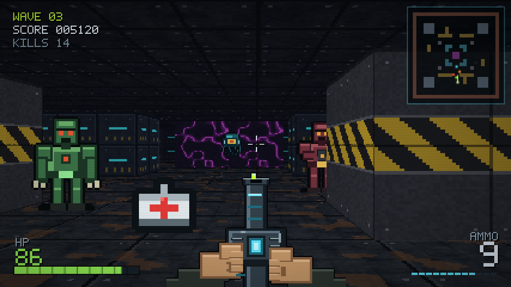
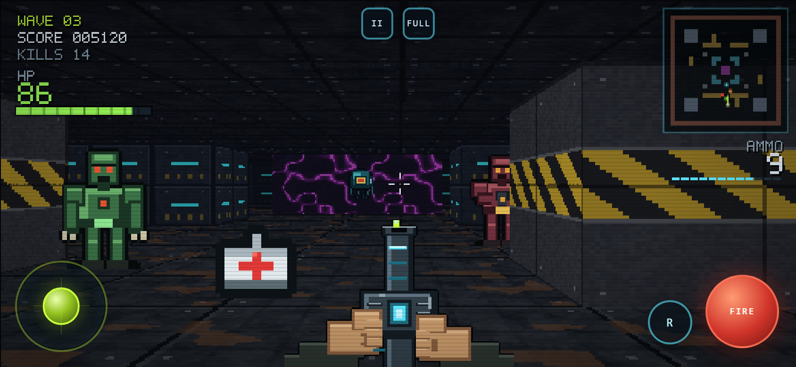

# VOID RUNNER

一个单文件、零外部素材的浏览器 FPS demo：用 **2D 网格 + 光线投射（raycasting）** 模拟第一人称 3D 视角，画面全部是像素风，贴图 / 敌人 / 枪械 / 音效都由代码在运行时生成。桌面端和手机触屏均可玩。

**在线试玩**：<https://ttt2718.github.io/void-runner/>

## 运行

双击 `index.html` 即可（Chrome / Edge / Firefox 均可，无需联网、无需安装）。

- 桌面端：点击「开始游戏」后浏览器会锁定鼠标；按 `Esc` 释放并暂停。
- 移动端：点击「开始游戏」后自动尝试**全屏 + 横屏**；如果浏览器不支持（例如 iOS Safari），会显示旋转提示，手动转成横屏即可继续。
- 窗口越大画面越大，内部始终按约 240p 渲染；手机横屏时为 519×240。
- 桌面调试触屏界面可加参数：`index.html?touch=1`。

## 操作

**桌面**

| 按键 | 功能 |
| --- | --- |
| `W` `A` `S` `D` | 移动 / 平移 |
| 鼠标 | 转向（需指针锁定） |
| 鼠标左键 | 射击（按住连射） |
| `R` | 换弹 |
| `Shift` | 冲刺 |
| `方向键 ←/→` | 无鼠标时的备用转向 |
| `Esc` | 暂停 / 继续 |
| `M` | 静音切换 |

**移动端**

| 操作 | 功能 |
| --- | --- |
| 左下虚拟摇杆 | 移动；推到底自动冲刺 |
| 右半屏拖动 | 转向 |
| `FIRE` | 按住射击 |
| `R` | 换弹 |
| `II` | 暂停 |
| `FULL` | 全屏 + 横屏 |

## 玩法

- 无尽波次：每波敌人数量、血量与速度逐步提升，清空后进入 4.5 秒整备并奖励分数。
- 初始武器为 12 发弹匣的脉冲步枪，打空自动换弹；命中时敌人白闪、喷血，击杀有概率掉落医疗包（+30 HP）。
- 三种敌人：
  - **Grunt（绿色近战）**：直冲脸，抬爪后造成 9 点伤害；
  - **Gunner（红色远程）**：保持距离发射能量弹，弹丸可走位躲开；
  - **Drone（青色浮游）**：高速逼近，体型小、血量低。
- 右上角小地图实时显示墙体、敌人、医疗包与玩家朝向。

## 技术实现

- 24×24 网格地图，逐列 DDA 光线投射，64×64 程序化墙体纹理 + 32 级预计算光照 LUT（含自发光像素）。
- 地板 / 天花板逐行仿射纹理投射；敌人与道具是 billboard 精灵，使用逐列 z-buffer 做遮挡。
- 内部渲染分辨率固定 240p 高、宽度随窗口比例变化（约 430×240），再用 `image-rendering: pixelated` 最近邻放大。
- 8 方向 BFS 流场寻路 + 敌人间分离力 + 圆形碰撞与贴墙滑行。
- WebAudio 实时合成枪声、命中、换弹、受伤、拾取与波次提示音。
- 触屏支持：Pointer Events 虚拟摇杆 / 右半屏滑动转向 / 射击换弹暂停键；HUD 在手机上自动让出底部两侧；使用 `env(safe-area-inset-*)` 适配刘海屏。
- 自动横屏：开始游戏时请求全屏并调用 `screen.orientation.lock('landscape')`；失败时冻结游戏并显示竖屏旋转提示，转横屏后自动恢复。
- 单文件约 97 KB；本机实测桌面渲染约 **1 ms/帧**，手机横屏模拟 519×240 同样稳定 60 fps。

## 文件

- `index.html` — 完整游戏（唯一必需文件）
- `preview.png` — 桌面画面预览
- `preview-mobile.png` — 手机横屏界面预览
- `README.md` — 本说明
